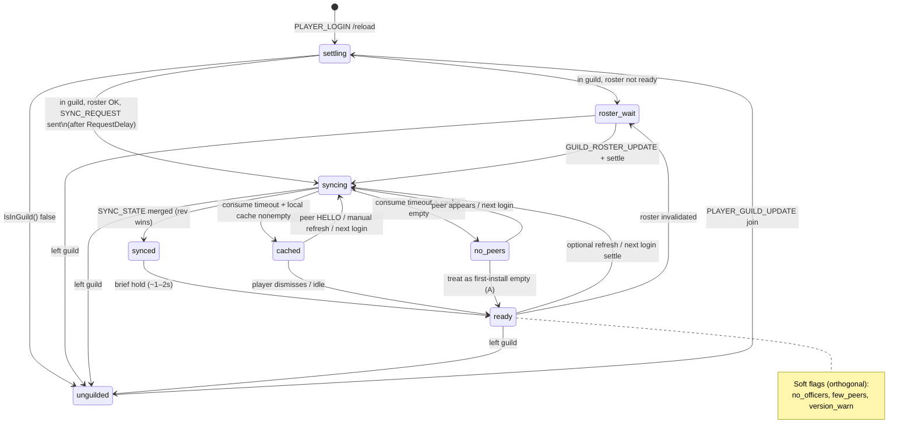

# 20 — Empty states, loading/sync, progressive disclosure (BeefNet)

**Audience:** Coding agents polishing Ladder / Standing / Officer chrome and any frame status chip tied to guild readiness or BeefNet reconciliation.  
**Authority:** Product law in `docs/superpowers/specs/2026-07-25-church-of-beef-design.md` (§8.2–§8.3, §10–§11); implementer locks in glossary rows 34–39, 59–62 ([74](../wow-classic-addon-design/74-v1-decision-glossary/locked-v1-decisions.md)).  
**Depth tracks (do not fork policy here):** [`41-empty-states-degraded-ux/`](../wow-classic-addon-design/41-empty-states-degraded-ux/), [`14-addon-messaging-beefnet/`](../wow-classic-addon-design/14-addon-messaging-beefnet/), [`67-offline-officer-suggestion-sync/`](../wow-classic-addon-design/67-offline-officer-suggestion-sync/), [`69-officer-tab-ia/`](../wow-classic-addon-design/69-officer-tab-ia/).  
**Copy inventory:** Prefer [41 beef-copy-ux-map](../wow-classic-addon-design/41-empty-states-degraded-ux/beef-copy-ux-map.md) over inventing new strings in this note.  
**Client:** TBC Classic Anniversary (`## Interface: 20506`). Research guidance — not a substitute for a green harness or in-client smoke.

---

## 1. One rule that prevents most bugs

**Never show “empty” while you still might be loading.** Blank panels and premature “No data” teach players the addon is broken ([NN/g empty states](https://www.nngroup.com/articles/empty-state-interface-design/)). For a guild mesh with no server, the dangerous sequence is:

1. Open `/beef` during login settle  
2. Ladder cache not merged yet (or roster not ready)  
3. UI flashes empty shelves / “no records”  
4. `SYNC_STATE` arrives → content appears  

Players who leave at step 3 never trust the Church again. Order of presentation:

**hard gate → settling/syncing → settled empty → populated**

Never the reverse. Syncing is a **system status**, not an empty state ([41 scenario matrix](../wow-classic-addon-design/41-empty-states-degraded-ux/scenario-matrix.md)).

---

## 2. What “networked” means for Beef (no server)

| Plane | Who sees it | Failure mode | UI job |
|-------|-------------|--------------|--------|
| **Local standing / events** | This client | Never needs peers | Always feel complete (Attune-shaped) |
| **Official ladder cache** | Addon peers via `RANK_COMMIT` + login `SYNC_*` | Offline during commit → stale until reconcile | Chip: syncing / cached / synced |
| **Pending suggestions** | Live `SUGGESTION` to online Officer+ only (V1) | Offline officers miss petitions by design ([67](../wow-classic-addon-design/67-offline-officer-suggestion-sync/v1-recommendation.md)) | “Petitions wait” — not “sync broken” |
| **Guild-chat spectacle** | Whole guild, addon optional | Officer opt-out / throttle | Escape hatch for non-installers |

Cousins that already ship this split: Attune (personal tree always; guild survey needs peers), Gargul (loot master installs; chat covers raiders), RCLootCouncil (Waiting → timeout → not installed), GRM (ambient sync; silence ≠ crash) — see [41 classic-cousin-patterns](../wow-classic-addon-design/41-empty-states-degraded-ux/classic-cousin-patterns.md).

**Product fork to watch:** the roster-backed ladder amendment may retire BeefNet rank replication as authority. If that lands, replace “ladder sync” chips with **roster readiness** language, but keep the same state-machine *shape* (settle → wait → ready / empty). Do not invent a second religion in UI Lua — update spec §15 if policy moves.

---

## 3. Empty-state taxonomy (five forces)

| Code | Scenario | UX type | Primary surface |
|------|----------|---------|-----------------|
| **A** | First install / empty cache (in guild) | Starting / learning empty | Ladder shelves + banner |
| **B** | Not in a guild | Hard gate | Ladder empty body; Standing paused |
| **C** | No officers online | Deferred authority | Status chip + Standing reassurance |
| **D** | Few / zero Church peers | Partial mesh | Quiet chip; never soft-lock |
| **E** | Sync pending / timeout | Loading / system status | Status chip only (keep cache visible) |

Plus **celebratory empty** (Officer queue cleared — “No petitions”) which must never share copy with E or “sync failed” ([69 empty-states-ia](../wow-classic-addon-design/69-officer-tab-ia/empty-states-ia.md)).

NN/g’s three jobs for any empty container ([NN/g](https://www.nngroup.com/articles/empty-state-interface-design/)):

1. **System status** — why this panel is thin  
2. **Learning cues** — what will appear when the Church is alive  
3. **Task pathways** — join guild / play with guildmate / wait for officer  

Classic chrome prefers **banner + chip + chat print**, not SaaS illustrations ([41 README](../wow-classic-addon-design/41-empty-states-degraded-ux/README.md)).

---

## 4. Progressive disclosure for a guild ladder

[Progressive disclosure](https://www.nngroup.com/articles/progressive-disclosure/) defers rare/advanced detail so the first glance stays task-shaped. For BeefNet-era UI, layers are **status depth**, not settings trees:

| Layer | When | What | Example |
|-------|------|------|---------|
| **L0 — Chip** | Any non-idle mesh/gate status | One short footer/header string | `Syncing ladder…` · `Not in a guild` |
| **L1 — Banner** | Hard gate or first-install only | Heading + why + next step inside tab body | Unguilded flock copy; “ranks await first names” |
| **L2 — Tip** | Settled thin mesh (optional) | One calm educational line | Guild-chat still shouts ranks; instance credit needs no peer addon |
| **L3 — Tooling** | Officer / V1.1 | Presence or version list | RCL-style Waiting → not installed (`/beef peers`) — not a V1 modal |

**Disclosure rules**

- One main idea per empty panel; personality in headings only ([41 copy map](../wow-classic-addon-design/41-empty-states-degraded-ux/beef-copy-ux-map.md)).  
- Compound states: show the **hardest gate** in the banner; secondary facts stay on the chip (B > E > A > C/D).  
- Hide Officer tab when not Officer+ — never grey-soup disclosure ([spec §11](../../superpowers/specs/2026-07-25-church-of-beef-design.md)).  
- Do not open L3 on every login; login catch-up must not RaidNotice-storm ([67](../wow-classic-addon-design/67-offline-officer-suggestion-sync/v1-recommendation.md)).

```text
Player opens /beef
  → L0 chip reflects UIStatus (below)
  → if hard gate (B): L1 banner, hide occupants
  → else show rank chrome + cache (never wipe for E)
  → if settled empty (A): L1 learning banner once
  → if thin mesh (C/D): L0 chip ± L2 tip; no scary banner
  → L3 only on explicit officer/debug path
```

---

## 5. BeefNet / login timeline → UI

Wire truth today (`Net/Sync.lua`): settle delay (~6s) → `SYNC_REQUEST` → peers jitter-reply `SYNC_STATE` (officer window first) → consume window (~45s) → `pendingRequest` cleared. Spec: keep cache if silence ([§8.3](../../superpowers/specs/2026-07-25-church-of-beef-design.md)).

| Wire moment | UIStatus | Ladder body |
|-------------|----------|-------------|
| `PLAYER_LOGIN` / before settle | `settling` | Show last SV cache if any; quiet chip OK |
| In guild, roster not ready | `roster_wait` | “Waiting for guild roster…” — do **not** flash B |
| `SYNC_REQUEST` sent | `syncing` | Keep cache; chip “Syncing ladder…” |
| First useful merge | `synced` | Brief chip; then `ready` |
| Consume timeout + had cache | `cached` | “Using cached ladder” |
| Consume timeout + empty cache | `no_peers` | Empty shelves (A) + pathway to ask an officer client |
| `IsInGuild()` false | `unguilded` | Hard empty (B); pause scoring / BeefNet |
| Soft: no Officer+ online | `ready` + flag `no_officers` | Chip only |
| Soft: version mismatch HELLO | `ready` + flag `version_warn` | Soft warn; do not apply incompatible commits |

**Must not:** block `/beef` on sync; clear ladder during `syncing`; treat timeout as hard error; label empty Officer queue as sync failure.

---

## 6. UI status state machine

Canonical enum for agents (single source of presentation priority). Soft flags are orthogonal bits, not exclusive states.

### 6.1 States

| UIStatus | Kind | Player-facing chip (default) |
|----------|------|------------------------------|
| `settling` | transient | *(quiet or “Starting Church…”)* |
| `unguilded` | hard gate | Not in a guild |
| `roster_wait` | transient | Waiting for guild roster… |
| `syncing` | transient | Syncing ladder… |
| `synced` | brief success | Synced |
| `cached` | settled degraded | Using cached ladder |
| `no_peers` | settled degraded | No peers online |
| `ready` | settled OK | *(chip hidden)* |

Soft flags (may decorate `ready` / `cached` / `no_peers`): `no_officers`, `few_peers`, `version_warn`.

### 6.2 Priority (banner vs chip)

When computing what to show:

1. `unguilded` → L1 banner; stop  
2. `settling` / `roster_wait` / `syncing` → L0 chip; **keep** any cache rows  
3. `synced` → brief L0; auto-advance to `ready`  
4. `cached` / `no_peers` → L0; if cache empty also L1 (A)  
5. `ready` → hide chip unless soft flags  
6. Soft flags → L0 only (never override 1–2)

### 6.3 Diagram



### 6.4 Transition table (implementer)

| From | Event | To | UI action |
|------|-------|-----|-----------|
| `*` | `IsInGuild()` false | `unguilded` | L1 B; pause score/net; hide Officer |
| `settling` | roster not ready | `roster_wait` | L0; do not claim unguilded |
| `roster_wait` / `settling` | roster ready + send `SYNC_REQUEST` | `syncing` | L0 Syncing; keep SV ladder |
| `syncing` | merge count > 0 | `synced` | L0 Synced; `RefreshLadder` |
| `syncing` | consume elapsed, cache > 0 | `cached` | L0 Using cache |
| `syncing` | consume elapsed, cache = 0 | `no_peers` | L0 + L1 A pathway |
| `synced` | timer | `ready` | clear chip |
| `ready` / `cached` | soft: no Officer+ | stay + `no_officers` | L0 only |
| `ready` | soft: sparse HELLO | stay + `few_peers` | L0 only |
| any guilded | major version HELLO mismatch | stay + `version_warn` | soft warn; drop bad commits |

---

## 7. Surface map (what each tab owns)

| Surface | Owns | Must not own |
|---------|------|--------------|
| Frame L0 chip / footer | UIStatus + soft flags | Rank thresholds, commit logic |
| Ladder tab | B / A banners; seven shelves; occupants from Core | Points grants; inventing “synced” without Net |
| My Standing | Local completeness; paused when unguilded | Mesh panic copy |
| Officer tab | Celebratory empty queue; rites chrome stays ([69](../wow-classic-addon-design/69-officer-tab-ia/empty-states-ia.md)) | “Sync broken” for quiet nights |
| Toasts | Suggestion / commit outcomes | Login sync progress spam |
| Guild chat | Spectacle for non-addon peers | BeefNet status dumps |

**Today’s code gap (orientation only):** `LadderTab` already has unguilded empty copy; Standing/Officer have action `status` lines — there is not yet a shared UIStatus chip driven by `COB.Sync.pendingRequest`. Prefer one frame-level presenter over per-tab inventing sync strings.

---

## 8. Antipatterns

| Antipattern | Why it hurts |
|-------------|--------------|
| Blank ladder, no banner | Spec forbids “command works, nothing appears” |
| “No records” during `syncing` | Classic NN/g inaccurate-empty failure |
| Blocking modal until sync completes | Soft-lock vs Classic login lag / CTL settle |
| Infinite “Syncing…” | Steal RCL timeout → cached / no peers |
| Empty Officer queue = sync error | Violates [67 UX honesty](../wow-classic-addon-design/67-offline-officer-suggestion-sync/v1-recommendation.md) |
| Nag “install Church” every open | Soft-lock culture; chat spectacle is the peer UX |
| Grey disabled Officer tab | Hide instead ([spec §11](../../superpowers/specs/2026-07-25-church-of-beef-design.md)) |
| UI inventing ranks while “waiting” | Layer rule: Net/Core only |

---

## 9. Agent acceptance checklist

- [ ] Hard gate B never flashes during `roster_wait`  
- [ ] `syncing` never clears cached occupants  
- [ ] Timeout always lands `cached` or `no_peers` (no infinite wait)  
- [ ] First-install A shows seven rank shelves + pathway, not “No data”  
- [ ] Officer quiet-empty ≠ mesh-degraded copy  
- [ ] Soft flags stay L0; only B/A use L1 banners  
- [ ] `/beef` opens regardless of UIStatus  
- [ ] No Retail-only loading skeletons; Classic FontString chip is enough  
- [ ] If roster-backed amendment ships: rename chips, keep this machine  

---

## 10. Sources & depth

**In-repo**

- [41 empty / degraded UX](../wow-classic-addon-design/41-empty-states-degraded-ux/) — scenario matrix, cousin patterns, copy  
- [14 sync-state-and-anti-spam](../wow-classic-addon-design/14-addon-messaging-beefnet/sync-state-and-anti-spam.md) — settle, request/reply, suppress  
- [67 offline suggestion sync](../wow-classic-addon-design/67-offline-officer-suggestion-sync/v1-recommendation.md) — petitions ≠ ladder sync  
- [69 officer empty IA](../wow-classic-addon-design/69-officer-tab-ia/empty-states-ia.md) — zone emptiness  
- Design spec §8.3 / §11; `addon/ChurchOfBeef/Net/Sync.lua` timing constants  

**External patterns**

- [Designing Empty States — NN/g](https://www.nngroup.com/articles/empty-state-interface-design/)  
- [Progressive Disclosure — NN/g](https://www.nngroup.com/articles/progressive-disclosure/)  
- [Progressive Disclosure pattern — UI-Patterns](https://ui-patterns.com/patterns/ProgressiveDisclosure)  
- [RCLootCouncil Version Checker](https://rclootcouncil.com/wiki/Version-Checker) (Waiting → timeout)  
- Search dump: `_search-empty-states-disclosure.json` (this folder)

---

## 11. Out of scope

- BeefNet byte budgets / CTL pacing (track 14)  
- Revision merge predicates (track 27)  
- Full microcopy voice bible (track 32)  
- Implementing the chip in Lua (Task / polish PR — this note is research only)
