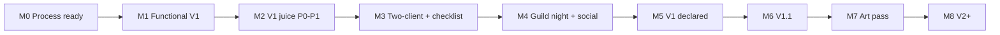

# 53 — Master development roadmap proposal

**Status:** Research **proposal** only — not product law, not a claim that V1 is complete.  
**Date:** 2026-07-26  
**Audience:** Maintainers and coding agents sequencing Church of Beef delivery after the agent-polish-vision research wave.  
**Authority (always wins):** [design spec](../../superpowers/specs/2026-07-25-church-of-beef-design.md) §10 / §13 / §14 / §15 · [`v1-checklist.md`](../../phases/v1-checklist.md) · [`ui-polished-direction-for-agents.md`](../../superpowers/ui-polished-direction-for-agents.md) · glossary 74–81 · `Data/Ranks.lua`.

If this proposal and the spec disagree, **spec wins**. Promote pieces into `docs/phases/`, the plan, or skills only after a human accepts them.

---

## 1. One-line verdict

**Finish V1 as a human-walked checklist (function + guild spectacle), while agents run gated polish loops on V1 juice only; then unlock V1.1 / art / V2–V4 juice phases under the same hands-off standards — never claim V1 complete from a green harness alone.**

---

## 2. Why integrate four strands

Today these tracks live in separate docs and risk racing each other:

| Strand | Primary docs | Risk if isolated |
|--------|--------------|------------------|
| **V1 checklist** | [`v1-checklist.md`](../../phases/v1-checklist.md), plan Task 13, guild-night playtest | Agents polish chrome while criteria 1–11 stay unticked |
| **Polish-loop methodology** | [29](29-superpowers-loop-patterns.md), [22](22-llm-critique-loops.md), [24](24-definition-of-done-polish.md), [31](31-loop-stop-conditions.md), [37](37-skill-draft-polish-loop.md) | Critique loops invent V2 theater or never stop |
| **Juice phases** | [38](38-juice-spectacle-roadmap.md), [42](42-v1-vs-v2-juice-scope.md), [11](11-game-juice-fundamentals.md), [14](14-celebration-spectacle-design.md) | Custom Media / SFX / dashboards sneak into Task 7–13 |
| **Hands-off agent standards** | [40](40-major-leaps-dev-standards.md), [30](30-writing-effective-agent-goals.md), [32](32-human-checkpoint-handoff.md), [verification.mdc](../../../.cursor/rules/verification.mdc) | Humans get pinged with “try `/beef`”; agents self-declare PASS |

This roadmap **serializes** them: functional gates first, V1 juice polish second, social spectacle as the V1 exit criterion, then post-V1 phases.

---

## 3. Current baseline (as of proposal date)

**Do not treat this as “V1 done.”** From [`v1-checklist.md`](../../phases/v1-checklist.md):

| State | Items |
|-------|--------|
| **Offline green** | `lua tests/run.lua` exit 0; TOC truth; missing-media smoke (vacuous — no `Media/`) |
| **Still open** | Spec §13 criteria **1–11**; two-client BeefNet walk; SV persist; announce opt-out; not-in-guild; officer tab hide; doc review; guild-night social check |

Plan Tasks 1–12 are implementation spine; Task 13 is “walk checklist + fix blockers,” **not** an art commission.

---

## 4. Operating system (how every milestone runs)

### 4.1 Authority order (never invert)

1. Design spec §10 / §15  
2. Glossary 68–71, **74–81**  
3. `Data/Ranks.lua` (numbers / titles only)  
4. UI agent briefing + build-prep canvas  
5. This research lane (process / juice craft)

### 4.2 Polish loop (default for UI / copy / toast / announce)

From [29 §3](29-superpowers-loop-patterns.md) + [24](24-definition-of-done-polish.md):

```text
DECLARE tier (P0|P1|P2) + one surface
  → IMPLEMENT vertical slice (major-leap Scope Card — see 40)
  → HARD VERIFY (harness if Core/Data; TOC; install → /reload → path)
  → RUBRIC / CRITIQUE (separate role; max 2–3 rounds — see 22, 31)
  → FIX or STOP (diminishing returns / blocker / law conflict)
  → HUMAN CHECKPOINT (H0–H5 — see 32) for CANDIDATE → PASS
  → Ledger; never claim V1 complete until checklist walked
```

| Polish tier ([24](24-definition-of-done-polish.md)) | Maps to juice |
|----------------------------------------------------|---------------|
| **P0** Process UI | Shell, tabs, empty states, officer IA |
| **P1** Feedback juice | Edge toasts, micro-motion, dual-encode |
| **P2** Social spectacle | Guild announce craft + §13.11 reaction |
| **P3** Art / SFX | **Post-V1 only** |

### 4.3 Hands-off agent standards (non-negotiable)

| Standard | Practice |
|----------|----------|
| **Major leaps** | One vertical slice or locked plan package per turn ([40](40-major-leaps-dev-standards.md)) |
| **Goals, not vibes** | Eight-block goal contract ([30](30-writing-effective-agent-goals.md)) |
| **Evidence before claims** | Fresh harness / TOC / BugSack — no “should work” |
| **Human gates sized correctly** | H0 install → H1 smoke → H2 two-client → H3 spectacle → H4 guild night → H5 full V1 walk ([32](32-human-checkpoint-handoff.md)) |
| **Artifact packs** | Agents prepare install path, SHA, smoke script, known risks **before** pinging a playtester |
| **Stop conditions** | Blockers, score plateau, max iterations, reopen-locked finding ([31](31-loop-stop-conditions.md)) |
| **Safety** | No WoW process control, no WTF wipes, no packager upload without approval |

### 4.4 Juice budget by product phase ([38](38-juice-spectacle-roadmap.md))

| Product phase | Juice / spectacle |
|---------------|-------------------|
| **V1** | `/g` + edge toasts + short fades; silent; Classic shell |
| **V1.1** | Streamer quieter preset (never kill announce); optional toast mute / thin track |
| **Art pass** | `Media/` + optional SFX default off — after shell + social check |
| **V2–V4** | Dashboard / Gora theater / Classic+ port — spec §14 |

---

## 5. Master milestones

Milestones are **exit-gated**. Later work may research earlier, but must not ship out-of-phase juice.



---

### M0 — Process ready (agent OS)

**Goal:** Agents can run hands-off without inventing religion.

| Deliverable | Gate |
|-------------|------|
| Workspace = `Beef_Addon`; `ADDON_ROOT` resolved | church-of-beef-dev §0 |
| Polish-loop skill draft reviewed ([37](37-skill-draft-polish-loop.md)) — install only if human approves | Skill present **or** § Polish loop added to church-of-beef-dev |
| Goal templates + stop conditions known to dispatchers | [30](30-writing-effective-agent-goals.md), [31](31-loop-stop-conditions.md) |
| Human handoff checklist usable | [32](32-human-checkpoint-handoff.md) |

**Agent autonomy:** High (docs/process).  
**Human:** Approve skill install; confirm `WOW_ADDONS_DIR`.

**Exit:** Orchestrators paste Scope Cards + polish-loop citation by default.

---

### M1 — Functional V1 spine (plan → client truth)

**Goal:** Every §13 mechanical path works on Anniversary; polish is secondary to blockers.

| Work | Maps to |
|------|---------|
| Close remaining plan gaps that block criteria 1–10 | Plan Tasks 7–12 residue / Task 13 blockers |
| Single-client: load, `/beef`, seven ranks, standing, suggestions, Gora/ceremony/instance grants | Checklist **1–6**, **10** |
| Offline harness stays green on Core/Data changes | Supporting check (already `[x]` — keep it) |

**Polish allowed:** Only **blocker fixes** (nil FontStrings, unusable Officer tab, missing empty states). No Media/, no SFX, no dashboard.

**Loop mode:** Major-leap vertical slices ([40](40-major-leaps-dev-standards.md)); critique optional unless UI-facing.

**Human checkpoints:** **H0** then **H1** per surface cluster.

**Exit:** Criteria **1–6** and **10** are *ready for dated ticks* (human may tick after smoke). **Do not** mark checklist complete from agent narrative alone.

---

### M2 — V1 juice pass (P0 + P1 only)

**Goal:** Process UI and feedback feel Classic-competent without inventing spectacle theater.

| Slice examples | Tier | Research anchors |
|----------------|------|------------------|
| MainFrame / tabs / clamp / empty states | P0 | [42 A](42-v1-vs-v2-juice-scope.md), [20](20-empty-states-disclosure.md) |
| Ladder density + local highlight | P0 | [06](06-guild-roster-ui.md), [18](18-color-hierarchy-readability.md) |
| Standing text thresholds + grant lines | P0 | Spec §10; no StatusBar |
| Officer four-zone + StaticPopup rites | P0 | [44](44-officer-commit-ux-juice.md) |
| Edge toasts (suggest / approve / credit) | P1 | [11](11-game-juice-fundamentals.md), [16](16-timing-curves-recipes.md), [09](09-performance-budgets.md) |
| Minimap glance tooltip | P1 | [05](05-minimap-ldb-patterns.md) |

**Loop mode:** Full polish loop — Gate A–E ([24](24-definition-of-done-polish.md)), rubric ([25](25-ui-polish-critique-rubric.md)), 2 critique rounds, max 3 fix iterations ([31](31-loop-stop-conditions.md)).

**Hard stops:** Anything in [42 V1 OUT](42-v1-vs-v2-juice-scope.md) / [38 Explicitly out of V1](38-juice-spectacle-roadmap.md).

**Human:** **H1** for P0/P1 CANDIDATE → PASS. Agents never self-PASS.

**Exit:** P0 and P1 at **POLISH: PASS** (or explicit human waiver) for Ladder, Standing, Officer, Toasts, Minimap.

---

### M3 — Two-client net + checklist walk (criteria 7–9 + supporting)

**Goal:** BeefNet / Commit / sync / forgery rejection proven; supporting SV/UX boxes ticked.

| Work | Checklist |
|------|-----------|
| Officer approve → member ladder + toast | **7**, BeefNet verification row |
| Offline member catches up on login | **8** |
| Forged `RANK_COMMIT` ignored | **9** |
| SV persist, settings persist, announce opt-out, not-in-guild, officer tab hide | Supporting checks |
| Doc review: UI matches canon; deferred marked later-phase | Verification approach |

**Polish allowed:** Sync-status clarity and empty/degraded copy only ([20](20-empty-states-disclosure.md), [45](45-beefnet-sync-status-ux.md) when present) — no new Net authority.

**Human:** **H2** mandatory. Artifact pack required ([32](32-human-checkpoint-handoff.md)).

**Exit:** Criteria **7–9** + supporting checks dated on real characters. Still **not** V1 complete (social check open).

---

### M4 — Guild night + spectacle (P2 + criterion 11)

**Goal:** V1’s product point — a promotion that gets a **visible guild reaction**.

| Work | Maps to |
|------|---------|
| Announce copy + throttle + officer checkbox | [07](07-chat-spectacle-ux.md), [14](14-celebration-spectacle-design.md) Medium tier |
| P2 polish loop on announce + promote toast only | [24](24-definition-of-done-polish.md) Gate D |
| Facilitated night: pacing, caps, source mix, sync storm | [`guild-night-playtest.md`](../../phases/guild-night-playtest.md), track 51 |
| Retune thresholds in `Data/Ranks.lua` if pacing fails | Spec §16 open Q; not docs/canon |

**Loop mode:** P2 polish → H3 rehearsal → **H4** full night. Spectacle Watcher owns criterion **11**.

**Exit:** Checklist **11** ticked with date + character notes; playtest metrics captured. Threshold retunes landed with harness green.

**Still not “V1 complete” until M5 formal walk.**

---

### M5 — V1 declaration (H5)

**Goal:** Honest completion — every box in [`v1-checklist.md`](../../phases/v1-checklist.md) `[x]` with date/character.

| Work | Owner |
|------|-------|
| Line-by-line checklist walk | Human (H5) with agent-prepared evidence pack |
| Task 13 closeout: debug hardened, README/TOC final | Agent under Task 13 |
| Spec §13 / §13.1 all green | Human sign-off |

**Forbidden at M5:** Shipping P3 art to “feel finished”; claiming complete from CI alone; skipping social check.

**Exit:** Maintainer states **V1 complete** in checklist / release notes. *This proposal does not make that claim.*

---

### M6 — V1.1 (privacy & ops; still not theater)

**Goal:** Playtest-driven ops without unlocking ceremonial chrome ([38 V1.1](38-juice-spectacle-roadmap.md)).

| Candidate | Constraint |
|-----------|------------|
| Streamer SV preset (mask names / quieter toasts) | **Must not** kill guild announce |
| Toast mute | Only if night proved noise |
| Thin Standing track 1–5 | Optional; not meter-dashboard |
| Suggestion pull-on-login | Default off; §15 amendment |

**Loop mode:** Same polish OS; every item needs §15 log before code.

**Exit:** Spec amendments + two-client smoke; announce still works under privacy preset.

---

### M7 — Art / media pass (P3)

**Goal:** Heraldry and optional SFX after the shell and social rite are trusted.

| Deliverable | Gate |
|-------------|------|
| Commission → TGA PoT → `Media/` + fallbacks | Packaging track 44; reopen missing-media checklist box |
| Optional SFX | Default **off**; no ripped Blizzard audio |
| Brand hex lock | Only after Anniversary screenshot pass |

**Exit:** Missing-media smoke green; shell still Classic; P3 POLISH: PASS.

---

### M8 — V2 → V4 (product phase map)

Per design spec §14 and [38](38-juice-spectacle-roadmap.md):

| Phase | Focus | Juice unlock |
|-------|--------|--------------|
| **V2** | Ceremonial dashboard, confessions, scripture, stream contrast | Spectacle surfaces beyond toast/`/g` |
| **V3** | Full Gora presentation / match theater | Theatrical favor meter — presentation only |
| **V4** | Classic+ port | Re-verify TOC/APIs; do not silently widen Anniversary V1 juice |

Each phase gets its **own** checklist (future `docs/phases/v2-checklist.md` etc.) and the same agent OS (leaps → polish loop → human H-gates).

---

## 6. Checklist × milestone matrix

| Checklist item | Milestone | Human gate | Polish tier |
|----------------|-----------|------------|-------------|
| Offline harness / TOC | Keep green every leap | Agent | — |
| Missing media (V1 vacuous) | M1; reopen at M7 | H0 / H1 | P0 → P3 |
| **1** Load Anniversary | M1 | H0–H1 | P0 |
| **2** `/beef` real frame | M1 | H1 | P0 |
| **3** Seven ranks + standing | M1–M2 | H1 | P0 |
| **4** Instance co-play | M1 | H1 (+ H4 pacing) | — |
| **5** Gora / ceremony | M1 | H1 | P1 toast only |
| **6** Suggestion, no auto-promote | M1–M2 | H1 | P0–P1 |
| **7** Officer Commit + BeefNet | M3 | **H2** | P1 |
| **8** Login sync | M3 | **H2** | P0 copy |
| **9** Forged commit rejected | M3 | **H2** | — |
| **10** No Retail / no bots | Continuous | H1 session | Gate A |
| **11** Social reaction | **M4** | **H3–H4** | **P2** |
| SV / settings / announce opt-out / not-in-guild / officer hide | M3 | H1–H2 | P0 |
| Doc review | M3–M5 | Human | — |
| Full walk dated | **M5** | **H5** | — |

---

## 7. Parallelism rules (hands-off without thrash)

Safe to parallelize inside a milestone:

| Parallel OK | Serialize |
|-------------|-----------|
| Independent P0 surfaces (Ladder vs Standing empty states) | Commit path vs forge-reject (shared Net) |
| Research notes vs implementation | Spec §15 amendments vs code that assumes them |
| Critic subagent vs builder (after diff exists) | P2 announce craft vs H4 guild night |
| Core harness extension vs UI pool-frame polish | Threshold retune vs social-check night (retune **after** metrics) |

Default bundle pattern ([40](40-major-leaps-dev-standards.md)): explore ∥ tests ∥ implement → parent merge → adversarial critique → human handoff.

---

## 8. Promotion path (research → law)

This file stays in `docs/research/`. Suggested human promotions (optional):

| Promote | Into |
|---------|------|
| Milestone names + gates | New `docs/phases/master-roadmap.md` or expand `docs/phases/` |
| Polish loop § | `.cursor/skills/church-of-beef-dev` or install [37](37-skill-draft-polish-loop.md) |
| “No UI done without reload smoke” | `verification.mdc` (already implied — make explicit if desired) |
| V1.1 / art triggers | Spec §15 decisions log |
| Per-phase checklists | `docs/phases/v1_1-checklist.md`, `v2-checklist.md`, … |

Until promoted, agents treat this as **recommended sequencing**, not a substitute for the V1 checklist.

---

## 9. Anti-roadmap (reject these “shortcuts”)

| Temptation | Why reject |
|------------|------------|
| Declare V1 complete from `879 passed` | Checklist + social check still open |
| Commission `Media/` to finish Task 13 | Spec / UI brief — words first |
| Overnight Ralph loop on UI without H1 | Violates evidence gate; false-green spectacle |
| Drive WoW client from agent loops | Forbidden by verification / safety |
| Pull V2 dashboard into M2 polish | [42](42-v1-vs-v2-juice-scope.md) hard partition |
| Privacy preset that mutes `/g` | Kills §13.11 |
| Agent self-PASS on polish | [24](24-definition-of-done-polish.md) — human only |

---

## 10. Milestone summary (quick index)

| ID | Name | Primary outcome |
|----|------|-----------------|
| **M0** | Process ready | Hands-off OS + polish loop wired |
| **M1** | Functional V1 spine | Criteria 1–6, 10 ready to tick |
| **M2** | V1 juice P0–P1 | Shell + toasts polish-passed |
| **M3** | Two-client + supporting | Criteria 7–9 + SV/UX boxes |
| **M4** | Guild night + P2 | Criterion **11** social reaction |
| **M5** | V1 declaration | Full checklist dated — human only |
| **M6** | V1.1 | Privacy/ops; no theater |
| **M7** | Art / media (P3) | Seals/SFX after shell earns it |
| **M8** | V2 → V4 | Spec §14 phases under same OS |

---

## 11. Related documents

| Doc | Role |
|-----|------|
| [`v1-checklist.md`](../../phases/v1-checklist.md) | Functional + social completion law |
| [V1 plan](../../superpowers/plans/2026-07-25-church-of-beef-v1.md) | Task file layout |
| [`guild-night-playtest.md`](../../phases/guild-night-playtest.md) | H4 ops |
| [38 juice roadmap](38-juice-spectacle-roadmap.md) | Phase juice budgets |
| [42 V1 vs V2 scope](42-v1-vs-v2-juice-scope.md) | Hard polish partition |
| [24 DoD](24-definition-of-done-polish.md) | P0–P3 gates |
| [29 polish-loop patterns](29-superpowers-loop-patterns.md) | Composite loop |
| [32 human handoff](32-human-checkpoint-handoff.md) | H0–H5 |
| [40 major leaps](40-major-leaps-dev-standards.md) | Hands-off SOP |

---

## 12. Explicit non-claim

> **This proposal does not assert that Church of Beef V1 is complete.**  
> Offline harness and TOC checks are preconditions. Completion requires a dated walk of [`docs/phases/v1-checklist.md`](../../phases/v1-checklist.md), including the guild-night social check.

---

## 13. Executive summary

Integrate four strands into one sequenced roadmap: **(1)** hands-off agent OS, **(2)** functional V1 spine, **(3)** bounded juice/polish, **(4)** human social proof. Milestones M0–M5 declare V1 only after checklist + guild-night; M6–M8 are post-V1. This proposal is research — not a dated sign-off.

---

## 14. Sourced practices

| Strand | Sources |
|--------|---------|
| Hands-off OS | [28](28-hands-off-cursor-workflows.md), [21](21-cursor-agent-loops-goals.md), Cursor hooks/cloud docs |
| Polish loop | [29](29-superpowers-loop-patterns.md), [24](24-definition-of-done-polish.md), [31](31-loop-stop-conditions.md) |
| Juice scope walls | [38](38-juice-spectacle-roadmap.md), [42](42-v1-vs-v2-juice-scope.md), UI brief / spec §10 |
| Completion law | `docs/phases/v1-checklist.md`, design spec §13, `verification.mdc` |

---

## 15. CoB-specific application

Execute milestones against the real tree: `addon/ChurchOfBeef/`, `tests/`, worktree layout per `AGENTS.md`. Do not reorder M4 (guild night) before two-client sync works. Do not pull V2 dashboard juice into M2.

---

## 16. Agent rules

1. Treat milestone IDs as planning aids — not automatic permission to skip human gates.  
2. Never mark M5 / V1 complete without a dated checklist walk.  
3. Refuse “shortcuts” listed in §9 (client automation, self-PASS polish, privacy mute of `/g`).  
4. Parallelize only per §7; one owner for canon/TOC.  
5. Promote research → law only via §8 path.

---

## 17. Open questions

1. Is M0 (process wiring) blocking for M1 code, or parallel?  
2. Which juice P0 items are in M2 vs deferred to M4 P2? (align [38](38-juice-spectacle-roadmap.md))  
3. Cloud env before or after hooks?  
4. Roster-backed ladder amendment — milestone rewrite needed?  
5. Who is the human signer for M5 (GM / streamer / maintainer)?

---

## 18. Source links

- Design spec §13–§15 · V1 plan · `docs/phases/v1-checklist.md` · `guild-night-playtest.md`  
- [21](21-cursor-agent-loops-goals.md) · [24](24-definition-of-done-polish.md) · [28](28-hands-off-cursor-workflows.md) · [29](29-superpowers-loop-patterns.md) · [32](32-human-checkpoint-handoff.md) · [38](38-juice-spectacle-roadmap.md) · [40](40-major-leaps-dev-standards.md) · [42](42-v1-vs-v2-juice-scope.md) · [52](52-gap-analysis-product-docs.md) · [54](54-development-standards-handbook.md)  
- [Cursor agent best practices](https://cursor.com/blog/agent-best-practices) · [Hooks](https://cursor.com/docs/hooks.md)
