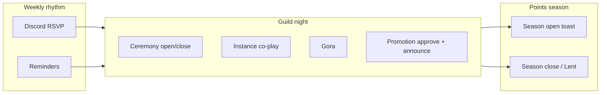

# Ritual cadence for points seasons

**Question:** How should Church of Beef time *nights*, *weeks*, and *seasons* so the ladder feels like liturgy rather than a spreadsheet?  
**Answer short:** **Guild night = atomic ritual.** Week = optional soft rhythm. Season (e.g. Lent) = the only honest reset/decay epoch. V1 ships none of the season machinery — design it now so thresholds and later decay don’t fight the calendar.

*Does not duplicate track 26:* that track covers ranking UX, toxicity, EPGP/DKP mechanics. Here: **when** rituals fire relative to points epochs.

## Product anchors

| Spec | Cadence meaning |
|------|-----------------|
| §4.2 pacing | First full dungeon night → first suggestion (Fresh → Cooked) |
| §7.1 ceremony | Officer-run event + attendance mark |
| §13 social check | One promotion with visible guild-chat reaction *during a guild night* |
| §16.3 Lent reset | Optional standing season if ladder saturates |
| §16.6 thresholds | Tuned after one real night of data |

## Three clocks

| Clock | Length (design default) | What happens | V1? |
|-------|-------------------------|--------------|-----|
| **Night** | One continuous session (e.g. 2–4h) | Ceremonies, co-play buckets, Gora, promotions | Yes — implicit |
| **Week** | Guild’s usual raid/social night(s) | Recurring expectation; Discord RSVP lives here | Social only |
| **Season** | Named epoch (4–12 weeks typical; “Lent” on-brand) | Standing freeze/reset/decay; optional title flair | Deferred |

## Night ritual skeleton (Beef-shaped)

Order is social, not code — officers may skip steps:

1. **Gather** — Discord event already fired; people zone in  
2. **Optional liturgy** — thin ceremony start (officer)  
3. **Play** — dungeon/raid/BG co-play scoring (caps apply)  
4. **Spectacle** — Gora challenge or promotion approve mid-night when energy is high  
5. **Close** — ceremony attendance marks; one throttled announce if ranks moved  
6. **Instrument** — officer (or alpha build) dumps night metrics → [beef-guild-night-instrumentation.md](beef-guild-night-instrumentation.md)

**Pacing rule from spec:** if a new member finishes a full dungeon night with guildmates and never sees a Cooked Beef suggestion, thresholds are too high — not “they need more calendar events.”

## Season design (post-V1, pre-commit the shape)

| Pattern | How it works | Fits Beef? |
|---------|--------------|------------|
| **Hard Lent reset** | Standing → 0 (or Fresh Beef) on season flip; titles optional keep/strip | Strong liturgy; harsh for casuals — make it a **named feast**, not a silent wipe |
| **Soft decay** | Periodic % decay (EPGP-style) | Feels like a tax; on-brand only if framed as “fasting,” not accounting |
| **Seasonal ladder parallel** | Lifetime title + season standing | Clearer UX, more UI — V2+ |
| **No season** | Points only go up (V1 default) | Fine until saturation (§16.3) |

**Recommendation for Church of Beef:** prefer **named hard/soft season boundaries** (Lent, Feast of the Fat Cow, etc.) over continuous decay. Continuous decay is EPGP’s answer to loot fairness; Beef’s answer to saturation should feel like a **holy calendar event**, announced once, officer-gated.

### Season boundary checklist (when implemented)

- Officer-only season flip (same authority story as `RANK_COMMIT`)
- Guild-chat liturgy line once (spectacle)
- Document whether Council/Prophet seats survive the season (almost certainly yes)
- Alts: still per-character (spec) unless doctrine changes
- Export or snapshot ladder for “eternal grazing” history (SavedVariables / officer copy)

## Cadence anti-patterns

| Anti-pattern | Why it hurts |
|--------------|--------------|
| Standing from Discord RSVP | Rewards signup theater; conflicts with in-game-only rule |
| Auto ceremony every Tuesday from calendar API | Fragile APIs; no officer judgment |
| Daily login standing | Turns church into chore app |
| Season reset without spectacle | Feels like a wipe exploit, not Lent |
| Multiple competing “activity point” seasons (Beef + GoW + EPGP) | Officers drown; Beef should stay the funny ladder |

## Mapping to existing guild tools

| External cadence | Beef relationship |
|------------------|-------------------|
| Discord weekly event | Source of *when* the night is — not a data feed |
| Arena / PvP seasons ([PvP season history](https://wowpedia.fandom.com/wiki/PvP_season)) | Metaphor only; do not couple standing to Blizzard PvP seasons |
| EPGP decay-after-raid | Contrast: loot fairness vs liturgical epoch |
| Raid lockouts on Classic Calendar | Orthogonal; never gate Beef standing on lockout expiry |

## Related

- [26-ladders-points-gamification](../26-ladders-points-gamification/) — decay/toxicity depth  
- [07-immersion-roleplay-flavor](../07-immersion-roleplay-flavor/) — ceremony presentation later  
- Spec §16.3 — Lent as open question