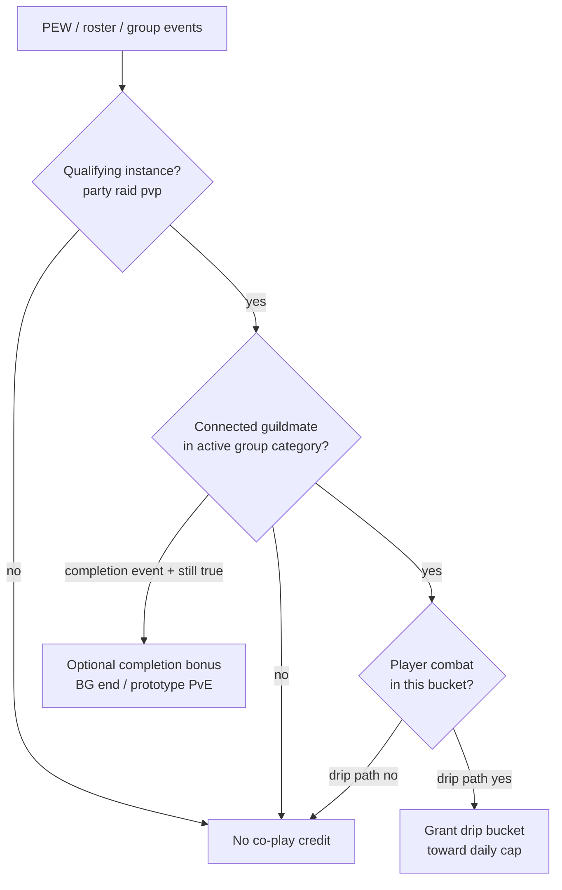

# Beef scoring map — guildmate presence → standing

**Track:** 59 · **Last updated:** 2026-07-25  
**Product truth:** [design spec §7](../../../superpowers/specs/2026-07-25-church-of-beef-design.md).  
**Instance/combat/completion signals:** track [15](../15-instance-completion-events/) as **inputs only**.

---

## 1. Credit pipeline

| Stage | Owner track | Predicate |
|-------|-------------|-----------|
| Session / instance type | 15 | `IsInInstance` → type ∈ {`party`,`raid`,`pvp`} |
| Guildmate presence | **59** | §2 below |
| Anti-AFK drip | 15 + §7.2 | Player entered combat in bucket |
| Completion bonus | 15 | BG winner / optional PvE — **re-check** guildmate at grant |
| Caps / DR | 26 / canon | Per-day / same-map |
| Official standing | 6 / 8 | Officer approve suggestion |

---

## 2. Canonical V1 guildmate predicate

**Name:** `HasConnectedGuildmateInActiveGroup`

**True when all hold:**

1. Player is in a group for the **correct** `LE_PARTY_CATEGORY_*` ([detection-methods](detection-methods.md)).
2. At least one UnitId in that group is not the player.
3. That unit is connected (`UnitIsConnected` / raid `online`).
4. That unit is same guild (`UnitIsInMyGuild` **or** normalized roster hit).
5. (Implied) Player’s own guild data is ready — if roster/`UnitIsInMyGuild` unknown, treat as **false** (no speculative credit).

**False when:** solo, only pets, only offline slots, only non-guild pugs, wrong category, not in guild.

**Peer addon:** not consulted.

---

## 3. Mapping to §7 sources

| Spec source | Needs guildmate predicate? | How 59 applies |
|-------------|----------------------------|----------------|
| Shared instance **drip** | **Yes** every bucket | Re-evaluate at bucket end before pay |
| Shared instance **completion bonus** | **Yes** at grant | BG end / optional clear — if guildmate dropped, no bonus |
| Ceremony | No (officer close) | Out of scope |
| Beef Gora | No (challenge APIs) | Out of scope |

Weight intent unchanged: small drip + completion; strict caps (§7.1–7.2).

---

## 4. Ship / defer / reject matrix

| Idea | Stance | Why |
|------|--------|-----|
| Group + `UnitIsInMyGuild` / roster in qualifying instance | **Ship** | Matches §7.1; Classic-safe |
| HOME vs INSTANCE category selection | **Ship** | Prevents BG/home dual-group bugs |
| Connected check on partner | **Ship** | Avoids offline raid-slot credit |
| Player combat gate on drip | **Ship** (track 15) | Spec anti-AFK |
| Require partner also in same instance ID | **Defer / Prototype** | Hardens park-outside abuse; validate need in playtest |
| `UnitIsAFK` hard gate | **Reject** as pay wall | Weak; combat supersedes |
| Proximity / `UnitInRange` / `CheckInteractDistance` | **Reject** for credit | False negatives + API restrictions |
| Open-world / city co-play | **Reject** | Spec §7.2; farm vector (track 26) |
| Credit for any BG teammate | **Reject** | Not guildmate |
| Wait for BeefNet HELLO from partner | **Reject** | Spec: peer need not run addon |
| Cross-realm / cross-guild church merge | **Reject** | Track 25 product law |

---

## 5. Scoring-event payloads (officer / suggestion UI)

When logging a local co-play event for suggestion breakdown (§7.3), prefer human-readable facts officers can laugh at:

| Field | Source |
|-------|--------|
| `instanceType` / name / id | Track 15 `GetInstanceInfo` |
| `guildmateNames[]` | Units that satisfied predicate (cap list length) |
| `groupCategory` | HOME / INSTANCE |
| `combatInBucket` | Track 15 sticky |
| `points` / `source=shared_instance` | Canon weights |

Do not require partner GUID for V1; optional later for rename tooling (track 25).

---

## 6. Interaction with pacing rule

Spec §4.2 / §7: first full dungeon night with guildmates → Fresh→Cooked suggestion.

| If detection is too strict | Symptom |
|----------------------------|---------|
| Roster race forever false | Night earns 0 → thresholds look too high |
| Wrong category in BG-only guild nights | PvP co-play under-credits |

| If detection is too loose | Symptom |
|---------------------------|---------|
| City groups / parked invite | Drip without content → officer rejects; pacing feels farmy |

**Tune order:** fix predicate correctness first, then canon drip numbers (track [51](../51-guild-night-playbook/) instrumentation).

---

## 7. Module responsibility sketch (docs only)

| Concern | Module (plan names) |
|---------|---------------------|
| Instance type / PEW / combat / completion | `Core/Instance.lua` (track 15) |
| `HasConnectedGuildmateInActiveGroup` | Same module or small helper — **this track’s contract** |
| Guild roster cache / normalize | `Core/Officer.lua` / roster util (track 16 + 25) |
| Caps / standing apply | Scoring / canon |
| Suggestion queue | Officer UI |

**V1 scoring blocker cleared when:** Instance drip path calls the guildmate predicate and playtest confirms dungeon-with-guildie pays and solo / city / pug-BG does not.
